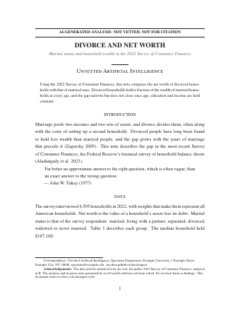
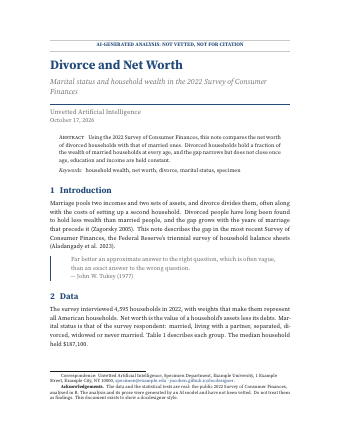
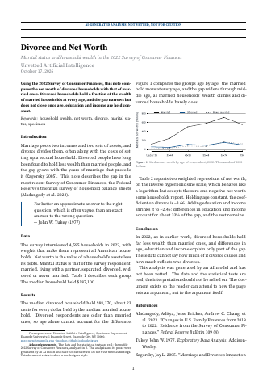
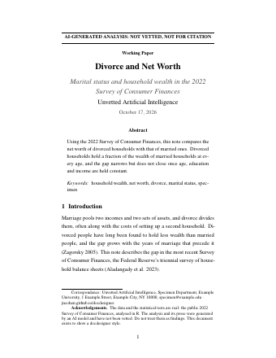
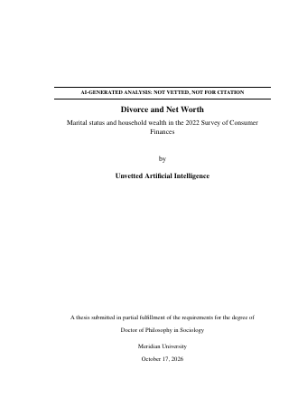
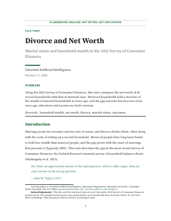

# Style gallery

Each style below sets the same short document. The left page shows the
title at the top of page 1. The right page shows a separate title page.
The two thesis styles show their title page and first chapter. Click a
page to open the PDF.

The specimen is a short note on divorce and net worth, using the public
2022 Survey of Consumer Finances. Its data and statistical tests are
real, but its analysis and prose were generated by an AI model and have
not been vetted. It is there to show the styles, not as a finding.

All

Academic

Public

One column

Two columns

### American Journal of Sociology `ajs`

academic set · one column · XITS

[Title on
page
1](https://jncohen.github.io/docdesigner/specimens/ajs-header.pdf "Open the Title on page 1 PDF")[Title
page](https://jncohen.github.io/docdesigner/specimens/ajs-page.pdf "Open the Title page PDF")

Modelled on the American Journal of Sociology: a centred title and
headings, a small-caps byline, footnotes and no colour.

Copy YAML

    output:
      docdesigner::pdf:
        style: ajs
        title_layout: header   # or page

### Demography `demography`

academic set · one column · EB Garamond

[Title on page
1](https://jncohen.github.io/docdesigner/specimens/demography-header.pdf "Open the Title on page 1 PDF")[Title
page](https://jncohen.github.io/docdesigner/specimens/demography-page.pdf "Open the Title page PDF")

Modelled on social-demography journals: EB Garamond with oldstyle
figures, small-caps section headings and near-black ink.

Copy YAML

    output:
      docdesigner::pdf:
        style: demography
        title_layout: header   # or page

### Methods `methods`

academic set · one column · Source Serif 4

[Title on page
1](https://jncohen.github.io/docdesigner/specimens/methods-header.pdf "Open the Title on page 1 PDF")[Title
page](https://jncohen.github.io/docdesigner/specimens/methods-page.pdf "Open the Title page PDF")

For methods and computational papers: Source Serif 4 with Fira Code for
code, a boxed abstract and teal headings.

Copy YAML

    output:
      docdesigner::pdf:
        style: methods
        title_layout: header   # or page

### Minimal `minimal`

academic set · one column · Latin Modern

[Title on page
1](https://jncohen.github.io/docdesigner/specimens/minimal-header.pdf "Open the Title on page 1 PDF")[Title
page](https://jncohen.github.io/docdesigner/specimens/minimal-page.pdf "Open the Title page PDF")

The look of an unstyled R Markdown PDF: Latin Modern, 1-inch margins and
black ink.

Copy YAML

    output:
      docdesigner::pdf:
        style: minimal
        title_layout: header   # or page

### Modern `modern`

academic set · one column · Source Serif 4

[Title
on page
1](https://jncohen.github.io/docdesigner/specimens/modern-header.pdf "Open the Title on page 1 PDF")[Title
page](https://jncohen.github.io/docdesigner/specimens/modern-page.pdf "Open the Title page PDF")

A clean preprint: Source Serif 4 with numbered blue section headings.

Copy YAML

    output:
      docdesigner::pdf:
        style: modern
        title_layout: header   # or page

### Nature `nature`

academic set · two columns · Source Serif 4

[Title
on page
1](https://jncohen.github.io/docdesigner/specimens/nature-header.pdf "Open the Title on page 1 PDF")[Title
page](https://jncohen.github.io/docdesigner/specimens/nature-page.pdf "Open the Title page PDF")

Modelled on Nature and Science articles: two columns of small type, a
bold abstract and a heavy rule above the title.

Copy YAML

    output:
      docdesigner::pdf:
        style: nature
        title_layout: header   # or page

### Queens College thesis `qc-thesis`

academic set · one column · XITS

[Title
page](https://jncohen.github.io/docdesigner/specimens/qc-thesis-thesis.pdf "Open the Title page PDF")[First
chapter](https://jncohen.github.io/docdesigner/specimens/qc-thesis-thesis.pdf "Open the First chapter PDF")

The thesis style with the Queens College title page for the MA in Data
Analytics and Applied Social Research, including a committee signature
block.

Copy YAML

    toc: true
    output:
      docdesigner::pdf:
        style: qc-thesis

### Sociology `sociology`

academic set · one column · Source Serif 4

[Title on page
1](https://jncohen.github.io/docdesigner/specimens/sociology-header.pdf "Open the Title on page 1 PDF")[Title
page](https://jncohen.github.io/docdesigner/specimens/sociology-page.pdf "Open the Title page PDF")

Modelled on ASA journals: a flush-left title, capital section headings,
a small-caps abstract label and no colour.

Copy YAML

    output:
      docdesigner::pdf:
        style: sociology
        title_layout: header   # or page

### SSRN `ssrn`

academic set · one column · XITS

[Title on
page
1](https://jncohen.github.io/docdesigner/specimens/ssrn-header.pdf "Open the Title on page 1 PDF")[Title
page](https://jncohen.github.io/docdesigner/specimens/ssrn-page.pdf "Open the Title page PDF")

A working paper in the NBER and SSRN tradition: a centred title,
numbered sections, spaced paragraphs and no colour.

Copy YAML

    output:
      docdesigner::pdf:
        style: ssrn
        title_layout: header   # or page

### Thesis `thesis`

academic set · one column · XITS

[Title
page](https://jncohen.github.io/docdesigner/specimens/thesis-thesis.pdf "Open the Title page PDF")[First
chapter](https://jncohen.github.io/docdesigner/specimens/thesis-thesis.pdf "Open the First chapter PDF")

A thesis or dissertation: double-spaced Times-like type, a 1.5-inch
binding margin, chapters on new pages, and a title page with an optional
signature block.

Copy YAML

    toc: true
    output:
      docdesigner::pdf:
        style: thesis

### Atlantic `atlantic`

public set · one column · EB Garamond

[Title on page
1](https://jncohen.github.io/docdesigner/specimens/atlantic-header.pdf "Open the Title on page 1 PDF")[Title
page](https://jncohen.github.io/docdesigner/specimens/atlantic-page.pdf "Open the Title page PDF")

Modelled on long features in The Atlantic: a large centred title, a drop
cap and red accents.

Copy YAML

    output:
      docdesigner::pdf:
        style: atlantic
        title_layout: header   # or page

### Bulletin `bulletin`

public set · two columns · Source Serif 4

[Title on page
1](https://jncohen.github.io/docdesigner/specimens/bulletin-header.pdf "Open the Title on page 1 PDF")[Title
page](https://jncohen.github.io/docdesigner/specimens/bulletin-page.pdf "Open the Title page PDF")

A two-column statistical bulletin: sans headings in blue bars, shaded
table rows, framed figures and a rule between the columns.

Copy YAML

    output:
      docdesigner::pdf:
        style: bulletin
        title_layout: header   # or page

### Economist `economist`

public set · two columns · Source Serif 4

[Title on page
1](https://jncohen.github.io/docdesigner/specimens/economist-header.pdf "Open the Title on page 1 PDF")[Title
page](https://jncohen.github.io/docdesigner/specimens/economist-page.pdf "Open the Title page PDF")

Modelled on The Economist: two columns, a red bar across the top of each
page, a red kicker and numbered sections.

Copy YAML

    output:
      docdesigner::pdf:
        style: economist
        title_layout: header   # or page

### Government `government`

public set · one column · Source Serif 4

[Title on page
1](https://jncohen.github.io/docdesigner/specimens/government-header.pdf "Open the Title on page 1 PDF")[Title
page](https://jncohen.github.io/docdesigner/specimens/government-page.pdf "Open the Title page PDF")

Modelled on federal statistical reports: a navy bar across the top of
each page, a Highlights summary and numbered sections.

Copy YAML

    output:
      docdesigner::pdf:
        style: government
        title_layout: header   # or page

### Humanities `humanities`

public set · one column · EB Garamond

[Title on page
1](https://jncohen.github.io/docdesigner/specimens/humanities-header.pdf "Open the Title on page 1 PDF")[Title
page](https://jncohen.github.io/docdesigner/specimens/humanities-page.pdf "Open the Title page PDF")

Modelled on university-press essays: EB Garamond with oldstyle figures,
a centred small-caps title and generous leading.

Copy YAML

    output:
      docdesigner::pdf:
        style: humanities
        title_layout: header   # or page

### Policy `policy`

public set · one column · Source Serif 4

[Title
on page
1](https://jncohen.github.io/docdesigner/specimens/policy-header.pdf "Open the Title on page 1 PDF")[Title
page](https://jncohen.github.io/docdesigner/specimens/policy-page.pdf "Open the Title page PDF")

A think-tank policy brief: a large flush-left headline, green accents, a
Summary block and ragged-right text.

Copy YAML

    output:
      docdesigner::pdf:
        style: policy
        title_layout: header   # or page

The specimens are made by `dev/render-specimens.R` in the
[repository](https://github.com/jncohen/docdesigner).
